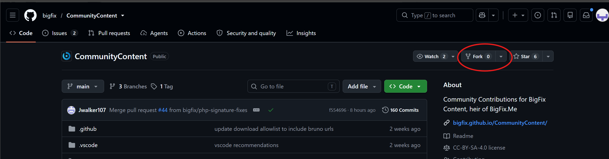
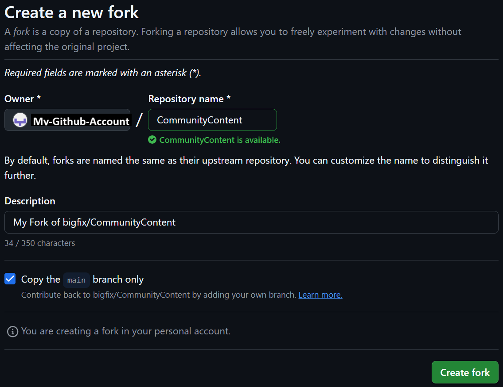
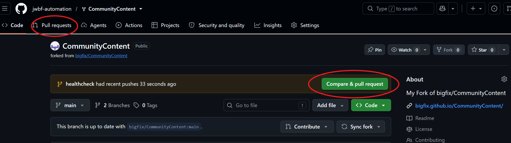

# Fork and Pull Request Guide: bigfix/CommunityContent

This instruction is based on a Command-line workflow for contributing to <https://github.com/bigfix/CommunityContent> (default branch: `main`). There are many graphical tools and IDEs that handle the Fork-and-Pull Request workflow natively, including Github Desktop and Visual Studio Code.

Read the repo's `CONTRIBUTING.md` and `README.md` first (licence CC BY-SA 4.0, attribution, representations).

> Git itself cannot create a fork or open a pull request; those two actions happen on GitHub (steps 1 and 6).

**Prerequisites:** Git installed and authenticated to GitHub. Never commit tokens or secrets.

---

## 1. Fork the repository

On <https://github.com/bigfix/CommunityContent>, click **Fork** → **Create fork**.


Set a target for your fork (a new repository under your own user github account.)



## 2. Clone your fork and add `upstream`
From a command line terminal, clone your fork of the repository.
The 'origin' remote will be your own fork.
Add a remote 'upstream' to link to the original bigfix/CommunityContent repository.
```bash
git clone https://github.com/<your-username>/CommunityContent.git
cd CommunityContent
git remote add upstream https://github.com/bigfix/CommunityContent.git
git remote -v   # origin = your fork, upstream = bigfix
```

## 3. Create a branch

Create a new 'branch' to track your changes.
This branch will exist in your fork of the repository.

```bash
git checkout main
git pull upstream main
git checkout -b add-<short-description>
```

## 4. Add or edit content

Add content using any editor you prefer.

- Fixlets/Tasks/Analyses: `Sites/<SiteName>/Fixlets/{Fixlets,Tasks,Analyses}/*.bes`
- Inventory signatures: `Signatures/`
- Filenames must **start with a letter** (numeric prefixes are auto-assigned on merge).
- Include attribution frontmatter if possible; keep original attribution on migrated bigfix.me content and note your changes.

Optionally validate locally with [pre-commit](https://pre-commit.com/) (same hooks as the repo's CI):

```bash
pre-commit run --all-files
git status
```

## 5. Commit and push

'Adding' files stages them to be included in your next commit.
'Committing' your changes creates a small archive containing your modifications, locally on your computer.
'Pushing' your changes uploads your committed change to your branch in your online fork of the repo (the remote named 'origin')

```bash
# use 'git add <filepath>' to stage either explicitly named files, or
# use 'git add .' or 'git add *' to stage all modified files in the directory or repository.
git add <path/to/your/files>
git add .

git commit -m "Add <SiteName>: <short description>"
git push origin add-<short-description>
```

## 6. Open the pull request

On GitHub, open your fork and click **Compare & pull request**. Target `bigfix/CommunityContent` `main`. In the description, explain what and why. Opening the PR confirms you accept the repo's licence terms.



If the **Compare & pull request** button is not visible on your fork (usually because your active branch has become idle), click on the **Pull requests** tab at the top and select your branch from your repo, to begin merging into the main branch of github.com/bigfix/CommunityContent

## 7. Respond to checks and review

GitHub Actions validate schema, filenames, whitespace, secrets, and download URLs. To fix a failure, push to the same branch; the PR updates automatically.

```bash
git add <files>
git commit -m "Address review feedback"
git push origin add-<short-description>
```

## 8. Keep your fork up to date

To keep your fork up to date, first switch back to your 'main' branch,
then pull any updates from the upstream (github.com/bigfix), and push those changes to your fork ('origin')

```bash
git checkout main
git pull upstream main
git push origin main
```

Then start your next contribution from step 3.
